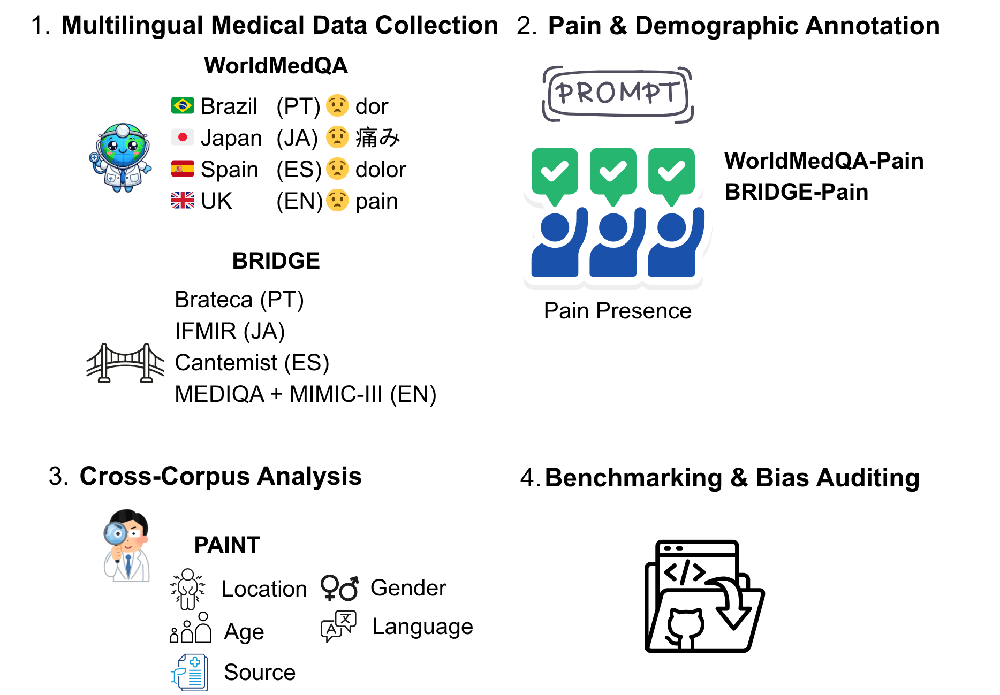

<p align="center"></p>

<h1 align="center">Multilingual pain representation, from medical licensing exams to clinical text</h1>

<p align="center">
  <a href="https://arxiv.org/abs/2610.18269"></a>
  <a href="https://github.com/tinaboya/PAINT/actions/workflows/check.yml"></a>
  <a href="https://huggingface.co/datasets/tinaboya/WorldMedQA-Pain"></a>
  
</p>

PAINT extracts pain and demographic attributes from medical licensing exam questions (WorldMedQA)
and from clinical notes (BRIDGE) in English, Spanish, Portuguese and Japanese.

Paper: [PAINT: A Framework for Multilingual Pain Representation from Medical Licensing Exams to
Real-World Clinical Texts](https://arxiv.org/abs/2610.18269), 6th Workshop on Multilingual
Representation Learning (MRL 2026) at EMNLP 2026, Budapest.

<p align="center"></p>

## Data

PAINT covers two kinds of medical text in the same four languages.

| | WorldMedQA-Pain | BRIDGE-Pain |
|---|---|---|
| Source | medical licensing exams ([WorldMedQA](https://github.com/WorldMedQA/V)) | clinical notes ([BRIDGE](https://github.com/YLab-Open/BRIDGE)) |
| Partitions | UK PLAB (en, 268), Spain MIR (es, 1,049), Japan NLE (ja, 742), Brazil REVALIDA (pt, 904) | MEDIQA (en), MIMIC-III (en), Cantemist (es), Brateca (pt), IFMIR (ja) |
| Records | 2,963 | 17,795 |
| In this repo | yes, with labels: `data/WorldMedQA-Pain/`, also on [Hugging Face](https://huggingface.co/datasets/tinaboya/WorldMedQA-Pain) | no, each corpus has its own data-use agreement |

The BRIDGE-Pain corpora are available from their providers: the open ones through
[BRIDGE-Open](https://huggingface.co/datasets/YLab-Open/BRIDGE-Open) on Hugging Face, MIMIC-III
through PhysioNet. With the corpora in hand you can regenerate the BRIDGE-Pain labels with the
code here.

## Repository contents

- `data/WorldMedQA-Pain/`: one CSV per partition with the question text and the ensemble labels,
  plus a dataset card. `load_dataset("tinaboya/WorldMedQA-Pain")` gives the same files as the
  splits `uk`, `spain`, `japan`, `brazil`.
- `model_outputs/`: the raw extractions of six models, so the labels can be rebuilt or changed.
- `annotation/completed_sheets/`: the sheets our clinicians returned, for the corpora we may share
  (the four WorldMedQA partitions, Cantemist, IFMIR), with the source text removed. Sheets for
  MIMIC-III, MEDIQA and Brateca are available on request to people who hold those corpora.
- `prompts/` and `PAINT-open-source-models/`: the prompts and the vLLM inference code.
- `src/paint/`: label building, evaluation and analysis. Standard library only.

## Data format

Each row of `data/WorldMedQA-Pain/<Partition>.csv` is one exam question.

| Column | Content |
|---|---|
| `row_index` | row position, starting at 0. Use it to join with `model_outputs/` and the annotation sheets. |
| `Question_ID`, `file_name` | WorldMedQA identifiers. `Question_ID` repeats across exam files; the pair is unique. |
| `Question` | the question in the original language. This is all the models saw. |
| `Question_EN` | English translation from WorldMedQA. For UK it is the same as `Question`. |
| `ensemble_pain_related`, `ensemble_pain_presence` | `True`, `False`, or `abstain` when the three models disagree |
| `ensemble_location`, `ensemble_pain_type` | items listed by at least two models, separated by `; `, in the original language |
| `ensemble_severity` | `mild`, `moderate` or `severe`, majority of the models |
| `ensemble_age`, `ensemble_gender`, `ensemble_ethnicity`, `ensemble_occupation` | age in years, gender `male`/`female`, ethnicity and occupation as free text; majority of the models |

In the last three rows, an empty cell means no model extracted anything and `abstain` means the models disagreed.

Clinicians checked pain relevance, pain presence, age, gender and occupation. Location,
descriptors, severity and ethnicity were not checked, and ethnicity categories mean different
things in different countries, so treat those columns with care.

The answer options, correct answer, specialty and year from WorldMedQA are not included. They are
in the [WorldMedQA repo](https://github.com/WorldMedQA/V).

Example, Brazil row 0:

> Mulher com 54 anos de idade, Índice de Massa Corpórea (IMC) = 32,6, portadora de diabetes tipo 2,
> ... comparece à Unidade Básica de Saúde com queixa de dor, do tipo cólica, em hipocôndrio
> direito, que se irradia para o ombro direito e piora após ingestão de alimentos, especialmente
> gordurosos. ...

pain related `True`, pain presence `True`, location `hipocôndrio direito; ombro direito`, type
`cólica`, severity empty, age `54`, gender `female`, ethnicity and occupation empty.

## Label statistics

| Partition | Items | Both pain fields resolved | Pain presence | Pain location | Age | Gender | Ethnicity | Occupation |
|---|---:|---:|---:|---:|---:|---:|---:|---:|
| UK PLAB (en) | 268 | 244 (91.0%) | 90 (33.6%) | 88 (32.8%) | 95.5% | 98.4% | 0.8% | 2.0% |
| Spain MIR (es) | 1,049 | 969 (92.4%) | 136 (13.0%) | 124 (11.8%) | 44.3% | 42.6% | 0.4% | 2.0% |
| Japan NLE (ja) | 742 | 689 (92.9%) | 112 (15.1%) | 109 (14.7%) | 49.8% | 49.9% | 0.6% | 5.2% |
| Brazil REVALIDA (pt) | 904 | 804 (88.9%) | 271 (30.0%) | 251 (27.8%) | 83.1% | 84.6% | 1.9% | 9.0% |

Pain presence and location are shares of all items (location counts items with pain presence and
a non-empty location). The demographic columns are coverage among the items where both pain
fields are resolved. The partitions are different exams written for different purposes, so do not
read these as prevalence.

## Running the code

```bash
python3 src/paint/build_wmqa_labels.py            # rebuild data/WorldMedQA-Pain/ from model_outputs/
python3 src/paint/build_wmqa_labels.py --check    # only compare; exits 1 on any difference
python3 src/paint/clinician_validation.py         # validation tables from annotation/completed_sheets/
python3 src/paint/inter_annotator_agreement.py    # kappa and agreement on the double-annotated records
python3 src/paint/kappa_transparency.py
python3 -m unittest discover -s tests
```

These run on a fresh clone with nothing installed. CI runs them on Python 3.9 and 3.12.

The evaluation scripts (`csv_to_eval_json.py`, `extraction_evaluation.py`, `ensemble.py`,
`analysis.py`) score the models against the clinician gold labels in `data/raw/WorldMedQA/`,
which we have not released yet, so they will not run from this repo for now. Inference
(`PAINT-open-source-models/`) needs a CUDA GPU and vLLM; see the README there. GPT-5 was run
through a hosted API.

[`REPRODUCE.md`](REPRODUCE.md) lists which command produces which number in the paper.

## Models

| Model | Role |
|---|---|
| [Gemma-4-E4B](https://huggingface.co/google/gemma-4-E4B) (4B) | ensemble member |
| [Qwen3-8B](https://huggingface.co/Qwen/Qwen3-8B) (8B) | ensemble member |
| [DeepSeek-R1-Distill-Qwen-32B](https://huggingface.co/deepseek-ai/DeepSeek-R1-Distill-Qwen-32B) (32B) | ensemble member |
| [GPT-5](https://platform.openai.com/docs/models/gpt-5) | closed-source reference |
| [LLaMA-3.1-8B-Instruct](https://huggingface.co/meta-llama/Llama-3.1-8B-Instruct), [MedGemma-4B](https://huggingface.co/google/medgemma-4b-it) | baselines we did not select |

The aggregation code is in `src/paint/analysis.py` (`_ensemble_demo`, `_ensemble_pain_aux`). Age
is normalised to years and gender to male/female with a small cross-lingual dictionary; ethnicity
and occupation stay as written.

## Intended use

WorldMedQA contains no patient data. The annotation study had an IRB exemption from MIT; the ten
annotators (nine physicians and one pharmacist) are co-authors. The MIT license covers the code
and the WorldMedQA-Pain labels. The clinical corpora keep their own terms.

PAINT is a research resource. Do not use it for diagnosis, treatment decisions or triage.

More detail: [`pain_definition.md`](pain_definition.md) (field definitions and the literature
behind them), [`annotation/README.md`](annotation/README.md) (how the clinician validation was
run), [`prompts/README.md`](prompts/README.md), [`model_outputs/README.md`](model_outputs/README.md).

## Citation

```bibtex
@misc{zhang2026paint,
  title         = {{PAINT}: A Framework for Multilingual Pain Representation from Medical Licensing Exams to Real-World Clinical Texts},
  author        = {Zhang, Boya and Ma, Yuanchao and Wu, Jiageng and Chaisutyakorn, Krittaphas and Gameiro, Rodrigo and Han, Ahram and Huang, Chien-Yu and Jaiswal, Nikhil and Leite, Marianna and Mora-Mau, Miriam and Pineda-Moreno, Jaime and Placino, Siena and Yamamoto, Ryohei and Jia, Yugang and Yang, Jie and Celi, Leo Anthony and Teodoro, Douglas},
  year          = {2026},
  eprint        = {2610.18269},
  archivePrefix = {arXiv},
  primaryClass  = {cs.CL},
  doi           = {10.48550/arXiv.2610.18269},
  note          = {Accepted at the 6th Workshop on Multilingual Representation Learning (MRL 2026), EMNLP 2026, Budapest}
}
```

## License

MIT for the code and the WorldMedQA-Pain labels, see [LICENSE](LICENSE). The BRIDGE-Pain corpora
are available from their providers under their own terms and are not re-hosted here.
